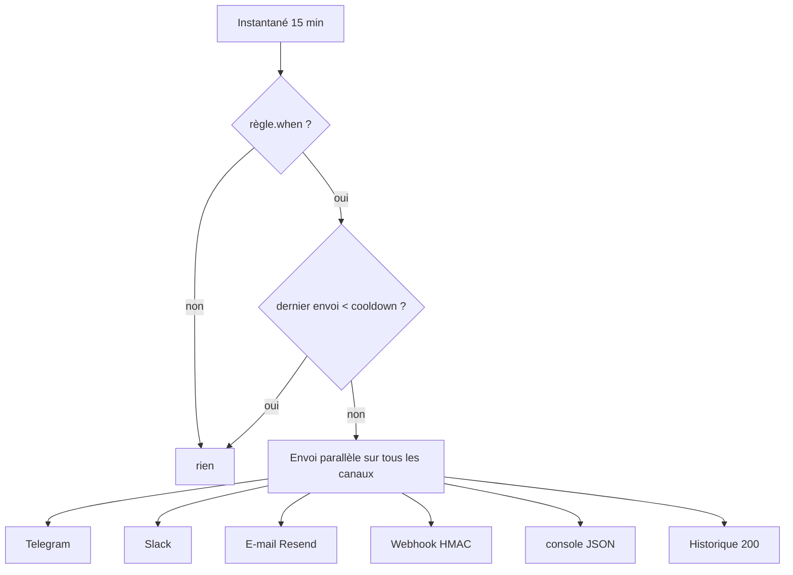

# 🚨 Alertes — `AlertManager`

## Règles par défaut

| Règle | Gravité | Condition (fenêtre 15 min, ≥ 20 requêtes) | Cooldown |
|---|---|---|---|
| `p95_latency` | high | p95 > 3 000 ms | 15 min |
| `error_rate` | high | taux d'erreur > 5 % (4xx hors 401/404 + 5xx) | 15 min |
| `error_5xx` | critical | 5xx / total > 2 % | 10 min |
| `db_slow` | medium | `db.query_time` p95 > 1 000 ms | 15 min |
| `apdex_low` | medium | Apdex < 0,8 (≥ 50 requêtes) | 30 min |

L'évaluation a lieu **toutes les 25 requêtes** dans `waitUntil()` (hors chemin critique), ou à la demande via `POST /api/admin/observability/evaluate`.

## Déduplication (anti-boucle)

Une même clé (`rule:<id>` ou `<gravité>:<titre>`) ne part qu'une fois par `cooldownMs`. Les suppressions ne sont pas comptées comme envoyées ; `getHistory()` liste les alertes réellement émises (200 dernières) et `resetDedup()` réarme tout.



## Canaux

::: code-group
```text [Telegram]
TELEGRAM_BOT_TOKEN + TELEGRAM_ADMIN_CHAT_ID
Message HTML : 🚨 <b>Titre</b> (service · env) / message / horodatage / métadonnées
```
```text [Slack]
SLACK_WEBHOOK_URL (Incoming Webhook)
Attachment coloré par gravité, champs = métadonnées
```
```text [E-mail]
RESEND_API_KEY + ALERT_EMAIL_TO=a@x.tn,b@x.tn (+ ALERT_EMAIL_FROM)
Sujet : [CRITICAL] Titre — rahma-academy · HTML responsive
```
```text [Webhook]
ALERT_WEBHOOK_URL (+ ALERT_WEBHOOK_SECRET)
POST JSON { service, env, alert } · en-tête X-Signature-256: sha256=HMAC(body)
```
:::

Vérification de la signature côté récepteur (Node) :

```js
const sig = crypto.createHmac('sha256', SECRET).update(rawBody).digest('hex')
if (req.headers['x-signature-256'] !== `sha256=${sig}`) return res.status(401).end()
```

## Alerte manuelle

```ts
import { createAlertManager } from './monitoring'
await createAlertManager(c).sendAlert({
  severity: 'high',
  title: 'Base de données surchargée',
  message: 'Le nombre de connexions simultanées dépasse 100',
  metadata: { connections: 125, threshold: 100 },
  key: 'db:connections'          // clé de déduplication explicite
})
```

## Règle personnalisée

```ts
import { getAlertManager } from './monitoring'
getAlertManager(c.env).rules.push({
  id: 'ai_quota', description: 'Quota IA quotidien presque atteint', severity: 'low', cooldownMs: 6 * 3600_000,
  when: m => (m.metrics['ai.generations']?.count || 0) >= 36,
  message: m => `${m.metrics['ai.generations'].count} générations sur 40 aujourd'hui`
})
```

## Gravités et routage recommandé

| Gravité | Signification | Qui | Délai de prise en charge |
|---|---|---|---|
| `critical` | service indisponible ou données en danger (5xx massifs, DB injoignable) | astreinte (Telegram + appel) | 15 min |
| `high` | dégradation sentie par les utilisateurs (p95, taux d'erreur, brute force) | équipe technique (Telegram + Slack) | 1 h |
| `medium` | dérive à surveiller (DB lente, Apdex, pic de trafic) | Slack / e-mail | jour ouvré |
| `low` | information (quota, test de canal) | e-mail | — |
