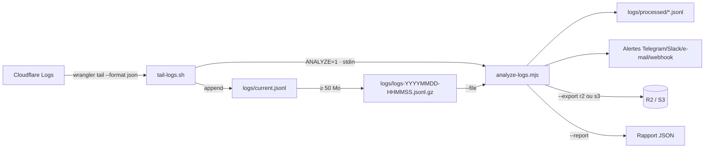

# 🛠️ Analyse des logs (`wrangler tail`)

Deux scripts interopérables dans `scripts/monitoring/`, sans dépendance npm.



## `tail-logs.sh` — capture continue

```bash
export CLOUDFLARE_API_TOKEN=… CLOUDFLARE_ACCOUNT_ID=…     # jamais `wrangler login`
PROJECT=webapp ENVIRONMENT=production scripts/monitoring/tail-logs.sh
ANALYZE=1 scripts/monitoring/tail-logs.sh                 # + analyse temps réel
STATUS=error scripts/monitoring/tail-logs.sh              # ne capter que les échecs
MODE=worker PROJECT=mon-worker scripts/monitoring/tail-logs.sh   # Worker classique plutôt que Pages
```

| Variable | Défaut | Rôle |
|---|---|---|
| `LOG_DIR` | `./logs` | dossier de sortie (`current.jsonl`, archives, `tail.err`) |
| `LOG_MAX_MB` | `50` | taille déclenchant la rotation (gzip en arrière-plan) |
| `LOG_KEEP` | `14` | nombre d'archives conservées |
| `RECONNECT_DELAY` | `5` | secondes avant reconnexion si le flux se coupe (redéploiement, réseau) |

::: info Limites de `wrangler tail`
Cloudflare limite le *tail* à ~ 10 sessions simultanées et peut **échantillonner** au-delà de ~ 1 000 req/s. Pour une capture exhaustive en production, préférez **Logpush** (plan payant) vers R2, puis `analyze-logs.mjs --file` sur les fichiers déposés.
:::

## `analyze-logs.mjs` — filtrage, anomalies, alertes, export

```bash
node scripts/monitoring/analyze-logs.mjs --file logs/current.jsonl --report
node scripts/monitoring/analyze-logs.mjs --file logs/logs-20261031-100000.jsonl.gz --level error --route /api/ai
node scripts/monitoring/analyze-logs.mjs --file logs/current.jsonl --tenant my-academy --report
node scripts/monitoring/analyze-logs.mjs --file logs/current.jsonl --export r2        # archive longue durée
cat logs/current.jsonl | node scripts/monitoring/analyze-logs.mjs --stdin --quiet
```

### Entrées reconnues
- lignes **`wrangler tail --format json`** (`outcome`, `event.request`, `logs[]`, `exceptions[]`) — les messages JSON du `RouteLogger` qu'elles contiennent sont **dépliés** ;
- lignes **RouteLogger** brutes (fichiers locaux, `pm2 logs`).

### Options
| Option | Rôle |
|---|---|
| `--level debug|info|warn|error` | sévérité minimale conservée dans `processed/` |
| `--route <préfixe>` · `--tenant <slug>` | filtres |
| `--window <ms>` | fenêtre d'analyse des anomalies (défaut 5 min) |
| `--report` | résumé final : volumes, p50/p95/p99, taux d'erreur, top 15 routes |
| `--export r2|s3` | envoi du fichier traité (SigV4 natif) |
| `--out <dir>` · `--quiet` | dossier de sortie · silence |

### Anomalies détectées (seuils via variables `T_*`)

| Id | Gravité | Condition (fenêtre 5 min) |
|---|---|---|
| `spike_5xx` | critical | ≥ 5 erreurs 5xx |
| `error_rate` | high | > 5 % d'erreurs (≥ 20 requêtes) |
| `latency_p95` | high | p95 > 3 000 ms |
| `traffic_spike` | medium | requêtes > 4 × la médiane des 24 fenêtres précédentes |
| `auth_bruteforce` | high | ≥ 20 échecs de connexion (`login_failed`, 401 sur `/api/auth/login`) |

Les alertes utilisent les **mêmes variables** que l'application (`TELEGRAM_*`, `SLACK_WEBHOOK_URL`, `RESEND_API_KEY`/`ALERT_EMAIL_TO`, `ALERT_WEBHOOK_URL`) avec déduplication `ALERT_COOLDOWN_MS` (15 min).

### Export longue durée

::: code-group
```bash [Cloudflare R2]
R2_ACCOUNT_ID=… R2_BUCKET=rahma-logs R2_ACCESS_KEY_ID=… R2_SECRET_ACCESS_KEY=… \
node scripts/monitoring/analyze-logs.mjs --file logs/current.jsonl --export r2
# → s3://rahma-logs/rahma-logs/2026-10-31/processed-2026-10-31-09.jsonl
```
```bash [Amazon S3]
S3_BUCKET=… S3_REGION=eu-west-3 AWS_ACCESS_KEY_ID=… AWS_SECRET_ACCESS_KEY=… \
node scripts/monitoring/analyze-logs.mjs --file logs/current.jsonl --export s3
```
:::

Rétention conseillée : **90 jours** en R2 (règle de cycle de vie), **1 an** pour les rapports mensuels. Les logs ne contiennent pas d'e-mails ni de mots de passe, mais des IP : purgez-les conformément à la loi tunisienne n° 2004-63 sur la protection des données.

## Automatisation (Docker)

```bash
cp .env.monitoring.example .env.monitoring   # renseigner les secrets
docker compose -f docker-compose.monitoring.yml up -d
docker compose -f docker-compose.monitoring.yml logs -f tail
```

- `tail` : capture + analyse temps réel + alertes ;
- `analyzer` : toutes les heures, rapport dans `logs/reports/` et export `LOG_EXPORT` ;
- `grafana` : http://localhost:3001 (voir [Grafana](/grafana)).

## Cron sans Docker

```cron
# analyse + export toutes les heures, rapport quotidien à 23 h 55
0 * * * *  cd /srv/rahma && node scripts/monitoring/analyze-logs.mjs --file logs/current.jsonl --level warn --quiet --export r2
55 23 * * * cd /srv/rahma && node scripts/monitoring/analyze-logs.mjs --file logs/current.jsonl --report --quiet > logs/reports/$(date +\%F).json
```
