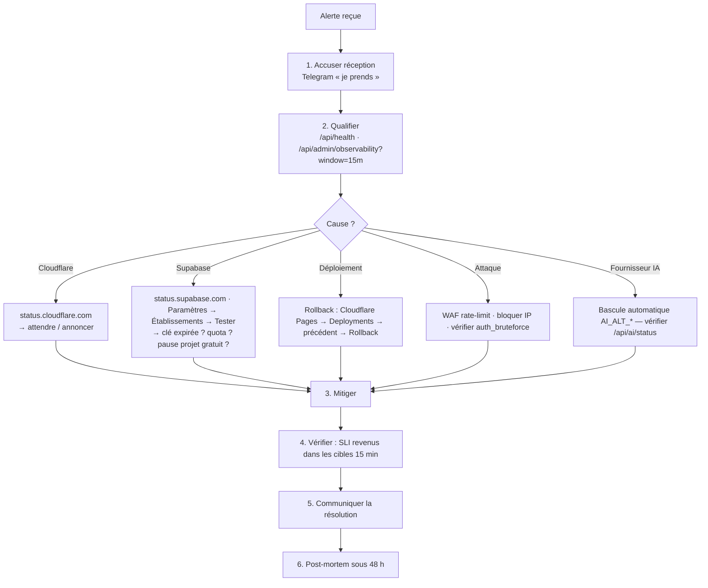

# 🧯 Procédures d'incident

## Gravités

| Niveau | Exemple | Délai de réaction | Communication |
|---|---|---|---|
| **P1 — critique** | site inaccessible, connexions impossibles, base Supabase injoignable, fuite de données | 15 min | message Telegram aux admins + bandeau sur la page d'accueil |
| **P2 — majeur** | paiements en échec, bulletins non générés, IA indisponible sans repli | 1 h | message aux enseignants concernés |
| **P3 — mineur** | lenteur ponctuelle, un module désactivé, alerte Apdex | jour ouvré | note dans le journal |

## Checklist de réponse (P1 / P2)



## Commandes utiles

```bash
# État instantané
curl -s https://<site>/api/health | jq
curl -s -H "Authorization: Bearer $T" "https://<site>/api/admin/observability?window=15m" | jq '.requests, .slo_status, .recentErrors[0:5]'

# Dernières erreurs en production
npx wrangler pages deployment tail --project-name webapp --status error --format json | head -50

# Retrouver une requête signalée par un utilisateur
grep "<X-Request-Id>" logs/current.jsonl | jq

# Tester la base d'un établissement (super-admin)
curl -s -X POST -H "Authorization: Bearer $T" https://<site>/api/tenants/admin/<id>/probe | jq

# Forcer l'évaluation des alertes / tester les canaux
curl -s -X POST -H "Authorization: Bearer $T" -H 'Content-Type: application/json' https://<site>/api/admin/observability/evaluate -d '{"force":true}'
```

## Rollback

1. *Cloudflare Pages → webapp → Deployments* → déploiement précédent → **Rollback to this deployment** (immédiat, sans rebuild).
2. Si la cause est une migration SQL : les migrations sont idempotentes (`IF NOT EXISTS`) ; ne jamais `DROP` en production. Restaurer via *Supabase → Database → Backups* (Pro) ou l'export JSON de *Paramètres → Sauvegardes*.
3. Vider le cache du Service Worker côté utilisateurs : incrémenter `CACHE` dans `public/sw.js` lors du correctif.

## Modèle de post-mortem

```markdown
# Post-mortem — <titre> — <date>
**Gravité** : P1 · **Durée** : 10:42 → 11:15 (33 min) · **Établissements touchés** : rahma, my-academy
**Impact** : connexions impossibles (≈ 120 utilisateurs), 0 perte de données
## Chronologie (UTC)
- 10:42 alerte `error_5xx` (Telegram) — 10:45 prise en charge — 10:51 cause identifiée — 11:10 correctif déployé — 11:15 SLI nominaux
## Cause racine
…
## Ce qui a bien fonctionné / ce qui a manqué
…
## Actions (responsable, échéance)
- [ ] …
```

Conservez les post-mortems dans `docs/monitoring/postmortems/AAAA-MM-JJ-<slug>.md`.
