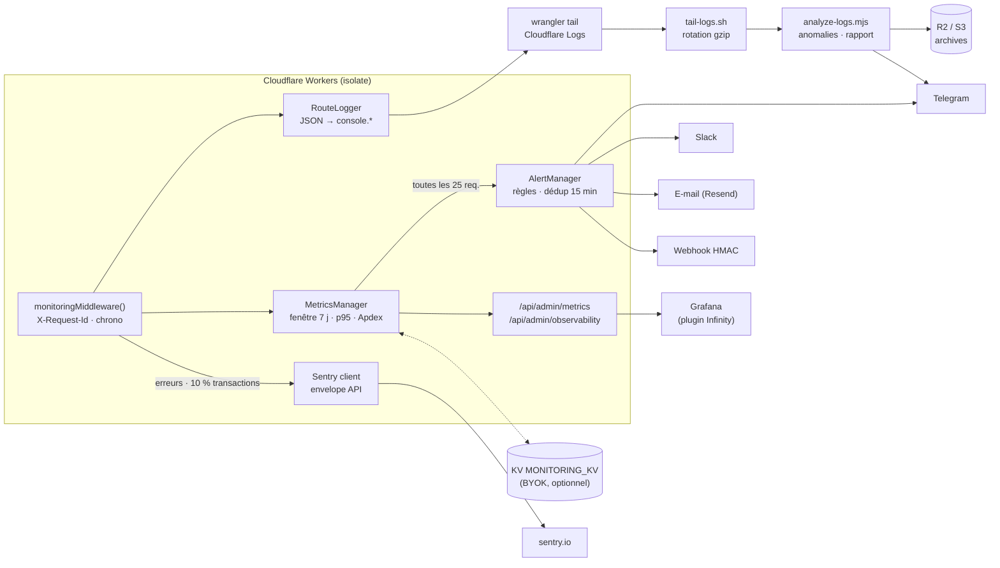
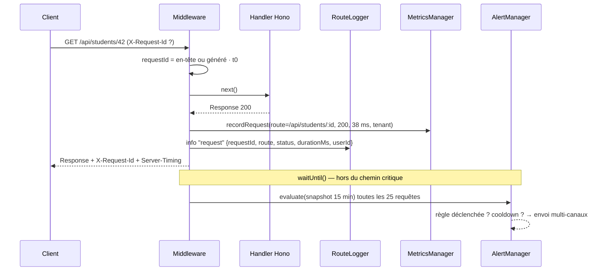

# 📊 Observabilité — Rahma Academy

Le système de monitoring de Rahma Academy fournit une visibilité complète sur la plateforme (Hono sur Cloudflare Pages/Workers, bases Supabase par établissement) :

- 📝 **Logs structurés** JSON (`RouteLogger`) avec niveau configurable, identifiant de requête et contexte (utilisateur, établissement, route, durée) ;
- ⚡ **Métriques** (`MetricsManager`) : volume, latence p50/p95/p99, taux d'erreur, Apdex, métriques personnalisées, **fenêtre glissante de 7 jours** ;
- 🚨 **Alertes** (`AlertManager`) : règles paramétrables, canaux Telegram / Slack / e-mail / webhook, **déduplication** anti-boucle ;
- 🔍 **Sentry** adapté aux Workers (API envelope, échantillonnage par environnement) ;
- 📈 **Endpoints d'administration** (`/api/admin/metrics` Prometheus & JSON, `/api/admin/observability`) et **tableau de bord Grafana** ;
- 🛠️ **Scripts d'exploitation** : capture `wrangler tail` avec rotation, détection d'anomalies, export R2/S3.

::: tip Fichiers concernés
`src/monitoring.ts` · `scripts/monitoring/tail-logs.sh` · `scripts/monitoring/analyze-logs.mjs` · `tests/monitoring.test.ts` · `grafana/` · `docker-compose.monitoring.yml` · `wrangler.toml.example`
:::

## Architecture

## Flux d'une requête

## Principes

| Principe | Mise en œuvre |
|---|---|
| **Zéro API Node** | uniquement `fetch`, `crypto.subtle`, `Headers` — compatible Workers |
| **Hors chemin critique** | Sentry, alertes, KV passent par `executionCtx.waitUntil()` |
| **Pas de données sensibles** | `redact()` masque `password`, `token`, `secret`, `api_key`… ; l'e-mail n'est jamais loggé |
| **Multi-établissement** | chaque échantillon porte le `tenant` ; filtres `?tenant=` sur l'API |
| **Mémoire bornée** | 20 000 échantillons / 5 000 points par métrique, purge 7 jours |
| **Testé** | 23 tests Vitest (`npm run test:monitoring`) |
