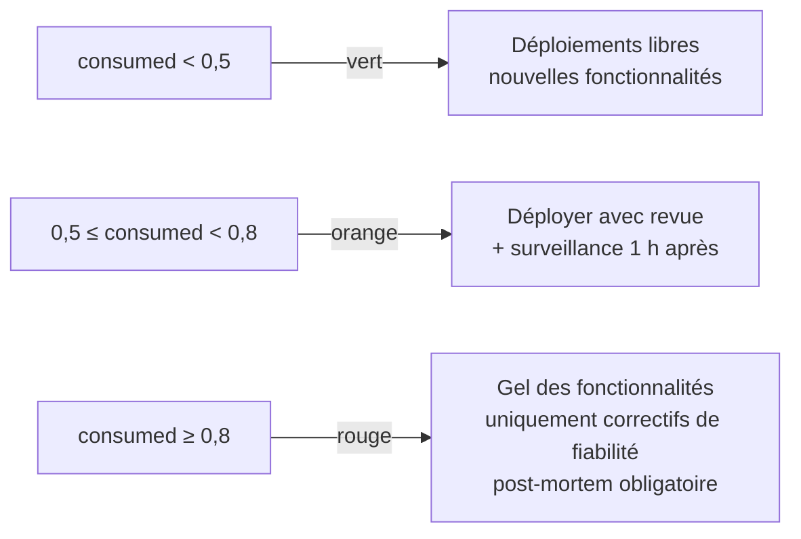

# 🎯 SLO / SLI et budget d'erreur

## Vocabulaire

- **SLI** (*Service Level Indicator*) : mesure observée (ex. part des requêtes servies sans 5xx).
- **SLO** (*Service Level Objective*) : cible sur un SLI sur une période (ex. 99,5 % sur 30 jours).
- **Budget d'erreur** : 100 % − SLO = la quantité d'échec « autorisée ». Il pilote les décisions : budget restant → on peut déployer ; budget consommé → on fige et on fiabilise.

## SLI mesurés par la plateforme

| SLI | Définition | Source |
|---|---|---|
| **Disponibilité** | `1 − 5xx / total` sur la fenêtre | `slo.availability.actual` |
| **Latence p95** | 95 % des requêtes API sous le seuil | `requests.p95` |
| **Taux d'erreur** | `(4xx hors 401/404 + 5xx) / total`, 0,1 % près | `requests.errorRate` |
| **Apdex** (satisfaction) | `(≤ 500 ms + ≤ 2 s / 2) / total` | `requests.apdex` |
| **Fraîcheur des alertes** | délai entre l'anomalie et la notification | historique `alerts.recent` |

## SLO cibles — Rahma Academy

Valeurs **paramétrables** dans `MONITORING_CONFIG.thresholds` et dans la réponse `/api/admin/observability → slo`. Elles tiennent compte du contexte : école tunisienne, usage en journée (7 h–19 h), pics à la rentrée et aux bulletins, réseau mobile.

| Parcours | SLI | SLO (30 j glissants) | Seuil d'alerte | Justification |
|---|---|---|---|---|
| **Plateforme (toutes routes)** | disponibilité | **≥ 99,5 %** (≈ 3 h 36 d'indisponibilité / mois) | 5xx > 2 % sur 15 min | Cloudflare + Supabase gratuits/pro ; pas d'astreinte 24/7 |
| **Connexion** (`/api/auth/*`) | disponibilité | **≥ 99,9 %** | 5xx > 1 % | porte d'entrée de tous les rôles |
| **Lecture pédagogique** (`/api/db/*`, bulletins, devoirs) | latence p95 | **≤ 1 500 ms** | p95 > 3 000 ms | pages consultées sur mobile par les parents |
| **Paiements** (`/api/payments/*`, quittances) | taux d'erreur | **≤ 0,5 %** | > 1 % | impact financier direct |
| **IA** (`/api/ai/*`) | latence p95 | **≤ 20 s** · taux d'erreur ≤ 5 % | 503 moteur | dépend de fournisseurs externes, bascule automatique |
| **Pages publiques** (`/`, `/inscription`, `/verifier`) | latence p95 | **≤ 800 ms** | p95 > 1 500 ms | statique + marque, pas de base |
| **Satisfaction globale** | Apdex | **≥ 0,85** | < 0,80 | T = 500 ms |

::: tip Adapter les cibles par établissement
Chaque tenant est mesuré séparément (`?tenant=<slug>`). Un établissement avec sa propre base Supabase dans une autre région peut avoir un SLO de latence propre : documentez-le dans *Paramètres → Établissements → Notes*.
:::

## Budget d'erreur

Pour la disponibilité à 99,5 % sur 30 jours :

| Période | Budget (temps d'indisponibilité équivalent) | Requêtes en erreur si 50 000 req/mois |
|---|---|---|
| 30 jours | 3 h 36 min | 250 |
| 7 jours | 50 min | 58 |
| 24 h | 7 min 12 s | 8 |

`error_budget.consumed` (0 → 1) dans `/api/admin/observability` = part du budget déjà brûlée sur la fenêtre. Politique :



## Alertes basées sur la consommation (*burn rate*)

Plutôt que des seuils fixes, surveillez la **vitesse** de consommation du budget :

| Fenêtre | Burn rate | Signification | Action |
|---|---|---|---|
| 1 h | > 14,4 × | 2 % du budget mensuel brûlé en 1 h | page immédiate (critical) |
| 6 h | > 6 × | 5 % en 6 h | high, intervention dans l'heure |
| 3 j | > 1 × | consommation au rythme exact du budget | medium, revue à la prochaine réunion |

Implémentation : règle personnalisée sur `m.requests.errors5xx / m.requests.total` comparé à `(1 − 0.995) × burnRate` pour la fenêtre choisie (`alertWindowMs`).

## Revue mensuelle (checklist)

- [ ] Exporter `/api/admin/observability?window=7d` chaque lundi (ou Grafana → *Share → Export*).
- [ ] Comparer SLI réels / SLO ; noter le budget restant.
- [ ] Lister les incidents (page [Incidents](/incidents)), causes, actions.
- [ ] Ajuster les seuils si > 3 faux positifs ou si une dégradation réelle n'a pas alerté.
- [ ] Vérifier les **coûts** (page [Coûts](/couts)) vs budget.

## Référence rapide des paramètres

```ts
// src/monitoring.ts
thresholds.responseTimeP95Ms = 3000   // SLO latence (alerte) — abaisser à 1500 pour la lecture pédagogique via category
thresholds.errorRate = 0.05           // taux d'erreur global
thresholds.error5xxRate = 0.02        // disponibilité
apdexTargetMs = 500                   // T de l'Apdex
// src/index.tsx → /api/admin/observability : slo.availability.target = 0.995, slo.apdex.target = 0.85
```
