# 🧵 Distributed Tracing

Suivre une requête de bout en bout : navigateur → Worker Hono → Supabase (base de l'établissement) → services externes (IA, Telegram, Konnect, Resend).

## Ce qui existe déjà

| Élément | Où | Rôle |
|---|---|---|
| `X-Request-Id` | entrant (optionnel) et **sortant sur chaque réponse** | identifiant de corrélation ; généré (20 hex) s'il est absent |
| `Server-Timing: app;dur=<ms>` | réponse | durée serveur, visible dans l'onglet *Réseau* des navigateurs |
| `requestId` dans chaque log | `RouteLogger` | retrouver toutes les lignes d'une requête : `grep <id> logs/current.jsonl` |
| `cfRay`, `colo` | logs | identifiant Cloudflare (`CF-Ray`) et datacenter — à donner au support Cloudflare |
| Transactions Sentry | 10 % échantillonnées | `GET /api/students/:id`, durée, statut, tenant |
| `timed('db.query_time', …)` | helper | durée des appels Supabase par table |

## Activer la propagation vers Supabase et les services externes

### 1. Propager le contexte dans `sb()`

```ts
// src/index.tsx — dans la fonction sb(env, path, opts) : ajouter l'en-tête de corrélation
const rid = requestIdCtx.getStore()   // AsyncLocalStorage (comme tenantCtx)
headers['X-Request-Id'] = rid
headers['traceparent'] = `00-${traceId}-${spanId}-01`  // W3C Trace Context (voir ci-dessous)
```

Supabase (PostgREST) journalise les en-têtes dans ses logs : *Supabase → Logs → API* puis filtre `request.headers.x-request-id = '<id>'` pour voir la requête SQL correspondante et sa durée côté base.

### 2. W3C Trace Context

Format standard reconnu par Sentry, Grafana Tempo, Jaeger, Honeycomb, Datadog :

```text
traceparent: 00-<trace-id 32 hex>-<span-id 16 hex>-01
```

```ts
// src/monitoring.ts — helper proposé
export function traceHeaders(c: Context) {
  const traceId = (c.req.header('traceparent') || '').split('-')[1] || crypto.randomUUID().replace(/-/g, '')
  const spanId = crypto.randomUUID().replace(/-/g, '').slice(0, 16)
  return { traceparent: `00-${traceId}-${spanId}-01`, 'X-Request-Id': getRequestId(c) }
}
// usage : fetch(url, { headers: { ...traceHeaders(c), Authorization: … } })
```

Le client (`app.js`) peut lire `X-Request-Id` et l'afficher dans les toasts d'erreur : *« Erreur serveur — référence e37218… »* → le support retrouve la trace instantanément.

### 3. Spans manuels (opérations longues)

```ts
const sentry = getSentry(c.env); const t0 = Date.now()
const pdf = await renderBulletin(student)
await sentry.captureTransaction({ name: 'pdf.bulletin', op: 'render', startMs: t0, endMs: Date.now(), tags: { level: student.level }, requestId: getRequestId(c) })
```

### 4. Visualisation

```mermaid
gantt
  title Trace e37218… — GET /api/grades/bulletin/42 (412 ms)
  dateFormat  x
  axisFormat  %L ms
  section Worker
  middleware · auth         :0, 6
  handler                   :6, 400
  section Supabase (my-academy)
  grades?student_id=eq.42   :12, 95
  subjects?select=*         :14, 40
  students?id=eq.42         :15, 38
  section Externe
  brand (cache)             :8, 1
  section Worker
  PDF jsPDF                 :110, 290
  réponse                   :400, 12
```



| Outil | Comment |
|---|---|
| **Sentry Performance** | transactions déjà envoyées ; ajouter des spans via `captureTransaction` (op `db.query`, `http.client`, `render`) |
| **Grafana Tempo / Jaeger** | exporter les spans en OTLP/HTTP depuis le Worker (`fetch` JSON vers `/v1/traces`) — même modèle « sans SDK » que Sentry |
| **Cloudflare Workers Trace Events** (Logpush) | corrélation par `CF-Ray` ; Paid plan |
| **Fichiers locaux** | `node scripts/monitoring/analyze-logs.mjs --file logs/current.jsonl --quiet` puis `grep <requestId> logs/processed/*.jsonl` |

## Bonnes pratiques

- Un **seul** identifiant par requête utilisateur : réutilisez `X-Request-Id` fourni par le client (SPA) si présent, sinon générez-le.
- Nommez les spans par **route normalisée** (`/api/students/:id`), jamais avec des identifiants réels.
- Ne mettez pas de données personnelles dans les tags (ni e-mail, ni nom) : `userId` et `role` suffisent.
- Échantillonnez (10 % en production) ; 100 % uniquement en développement ou pendant une investigation d'incident (`SENTRY_TRACES_SAMPLE_RATE=1` temporaire).
